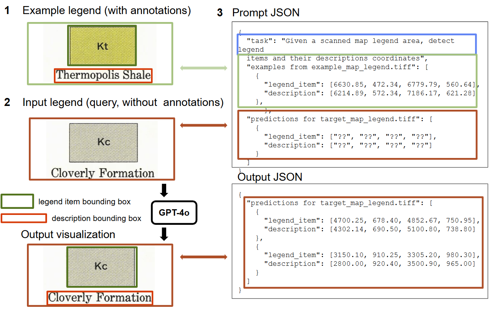
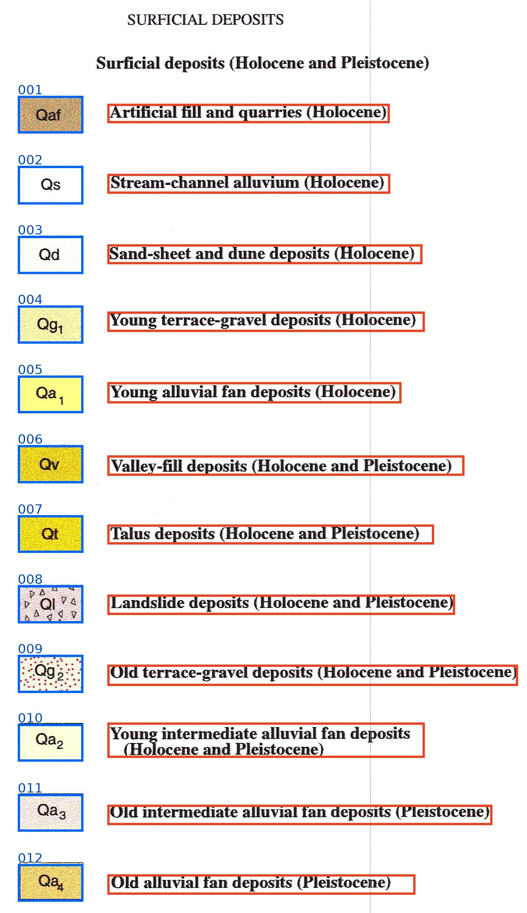
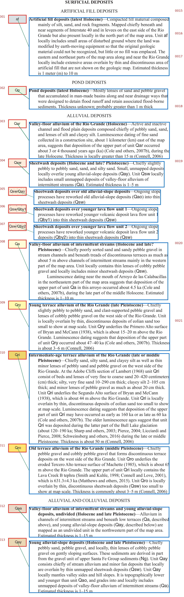

# CriticalMAAS Legend Detection

Code accompanying **[Detecting Legend Items on Historical Maps Using GPT-4o with In-Context Learning](https://doi.org/10.1145/3764920.3770590)**, by Sofia Kirsanova, Weiwei Duan, and Yao-Yi Chiang (GeoSearch 2025).

The pipeline crops legend regions with LARA, presents an annotated example legend and a target legend to GPT-4o, and predicts bounding boxes linking legend items to their descriptions. It supports the paper's 5, 10, 15, and 20 in-context example settings.



## Setup

Use Python 3.10 or newer:

```bash
git clone https://github.com/knowledge-computing/criticalmaas-legend-detection.git
cd criticalmaas-legend-detection
python -m venv .venv
source .venv/bin/activate
python -m pip install -e .
cp .env.example .env
```

Set `OPENAI_API_KEY` in `.env`. The file is ignored by Git. See the [OpenAI API quickstart](https://developers.openai.com/api/docs/quickstart) for creating a key. [GPT-4o](https://developers.openai.com/api/docs/models/gpt-4o) is the default model in `config_detection.yaml`.

## Run GPT-4o

Obtain legend-region segmentation JSON from [LARA](https://github.com/DARPA-CRITICALMAAS/uncharted-ta1/tree/main/pipelines/segmentation), using its trained segmentation model. Prepare one annotated example and a different target map:

```bash
legend-icl prepare \
  --image data/maps/example_map.png \
  --annotation data/annotations/example_map.json \
  --segmentation data/segmentation/example_map_map_segmentation.json \
  --output data/prepared/example_map

legend-icl prepare \
  --image data/maps/target_map.png \
  --segmentation data/segmentation/target_map_map_segmentation.json \
  --output data/prepared/target_map

legend-icl infer \
  --example data/prepared/example_map/record.json \
  --target data/prepared/target_map/record.json \
  --config config_detection.yaml \
  --num-examples 15 \
  --output outputs/gpt4o
```

The example annotation must contain at least 15 paired rectangles. LabelMe rectangles use `legend` and `description` labels with a shared `group_id`. Coordinates are `[xmin, ymin, xmax, ymax]` in source-image pixels. For an existing legend crop, replace `--segmentation ...` with `--already-cropped` and supply annotations in that crop's coordinates.

Each run saves the prompt, raw response, linked bounding boxes in `predictions.json`, and an annotated image in `overlay.png`. Add `--dry-run` to prepare inputs without making an API request.

For the 5/10/15/20 example experiment, edit `configs/experiment.example.json` to list separate example and target records. Supply target annotations during preparation and at least 20 example pairs, then run:

```bash
legend-icl experiment \
  --manifest configs/experiment.example.json \
  --config config_detection.yaml \
  --output outputs/gpt4o-experiment
```

## Results

[Download the gallery and JSON results](https://drive.google.com/file/d/1PNZ4BdREYQUKfKPv6xe4Oci090CCWU3S/view), or [browse the complete results collection](https://drive.google.com/drive/folders/1QBa-5ZM5Q6xA12eEq30fZLPUuExTAvUp) for full-resolution overlays and legend detail images. Extract the gallery ZIP and open `index.html` in a browser.

Visual results cover 19 historical maps, with legend items, descriptions, symbol associations, and correlation-chart entries. Two examples are shown below.



USGS MF-2367: symbol and description boxes in a compact unit list.



USGS SIM-3447: symbols linked to multiline geological descriptions.

## Citation and license

Please cite the paper linked above; bibliographic metadata is provided in [CITATION.cff](CITATION.cff). Code is licensed under [MIT](LICENSE). The manuscript workflow figure retains its publication rights.
